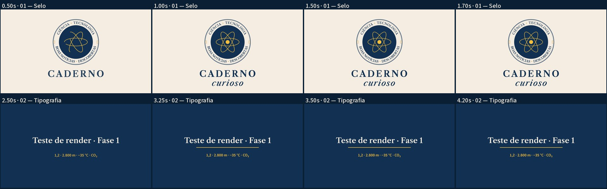

# QA — Fase 1: render de teste técnico (`episodes/_smoke`)

**Estado: teste técnico. Nada aqui está aprovado.** O áudio são tons sintéticos que imitam
palavras (não é voz); o conteúdo é só tipografia, selo e transição.

## O que foi renderizado (12/11/2026, nesta sessão de nuvem, 4 vCPU)
| Perfil | Resolução | Quadros | Duração | Render | Tamanho |
|---|---|---|---|---|---|
| preview | 1280×720, H.264 CRF 23 veryfast | 135 | 4,500 s | 1,8 s (2 processos) | 152 KB |
| entrega | 1920×1080, H.264 CRF 18 medium | 135 | 4,500 s | 3,6 s (2 processos); 4,5 s com 1 processo | 314 KB |

Áudio AAC 48 kHz estéreo, loudness normalizado para −16 LUFS (EBU R128).

## Verificações automáticas: 25 de 25 passaram, em 720p e em 1080p
Formato (dimensões, 30 fps, H.264 yuv420p, nº de quadros, duração, faststart), imagem
(sem congelamento > 2 s, sem quadros vazios), áudio (presença, AAC 48 kHz, cobertura,
−15,3 LUFS, pico −8,5 dBTP, sem clipping, silêncios só nas pausas), sincronia (âncoras
≤ 17 ms, som em cada palavra, corte em pausa), legibilidade (4 textos: corpo, tempo,
contraste ≥ 4,5:1, margem 5 %), SRT válido, direitos (8 arquivos de fonte com OFL; nenhum
dos 100 hashes da Reforma), fontes científicas (declarado "não aplicável").

O primeiro QA **reprovou** a linha de números (ficava 2,2 s para 41 caracteres; mínimo
2,46 s): o texto foi encurtado. A inspeção visual também achou dois defeitos que o QA não
pegou e que foram corrigidos: palavras espremidas no anel inferior do selo e o crossfade
"turvo" (o selo sumia antes da mistura).

## Limitações reais
- O render é curto e simples: os tempos **não** predizem episódios de 10 min com mapas e
  imagens. A estimativa do workflow usa fatores conservadores (3 s/s em 1080p), a medir de verdade.
- O selo é uma reconstrução a partir de um bitmap de 1254 px: proporções medidas, letras
  posicionadas por cálculo; a fonte do anel é a serifada provisória, não a original.
- O detector de congelamento usa quadros reduzidos a 160×90: movimentos muito pequenos
  (ex.: um ponto piscando) podem passar como "parado".
- O teste de "silêncio onde há fala" depende de `words.json` correto; com TTS (Fase 2) os
  tempos virão do alinhamento, que também precisa de revisão.
- Os workflows ainda **não foram executados** no GitHub Actions (só validados por teste local).
- Ninguém assistiu ao vídeo com som ainda: a avaliação humana está pendente.
